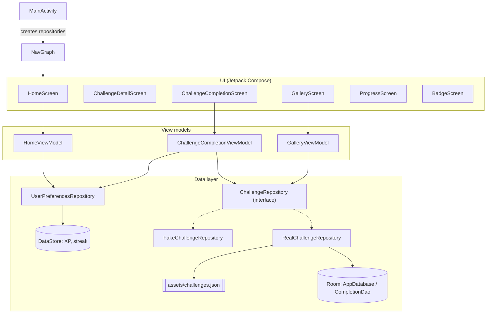

# KatjaStudio

Android app for a daily drawing routine. It suggests one drawing challenge per day, lets you mark it as done with a picture, and collects the finished drawings in a gallery.

> **Status: early prototype.** The challenge flow works. Progress and badges are still placeholder screens.

## Features

- **Daily challenge:** one challenge per day, picked from a local list (`app/src/main/assets/challenges.json`).
- **Challenge detail and completion:** open a challenge and complete it with a picture.
- **Gallery:** all finished drawings in one place.
- **XP and streak counter:** stored on the device; a completed challenge gives 50 XP.
- **In progress:** progress view (XP and streaks) and badges.

## Tech stack

- Kotlin, Jetpack Compose with Material 3
- Navigation Compose, ViewModels
- Room for completed challenges, DataStore for preferences
- Coil for images
- Min SDK 26, target SDK 36

## Run it

1. Open the project in Android Studio.
2. Let Gradle sync, then run the `app` configuration on an emulator or a device.

Everything is stored locally on the device. The app has no account and no backend.

## Architecture

The app follows a simple layered design: Compose screens read state from view models, the view models talk to repositories, and the repositories use a local database, the preferences store and a bundled challenge list. There is no network access.



`MainActivity` picks the repository: `RealChallengeRepository` in normal use, `FakeChallengeRepository` in test mode.

## Project layout

```
app/src/main/java/de/kataia/app/
  data/        Room database, repositories, preferences
  model/       Challenge, ChallengeCompletion
  navigation/  navigation graph and screens
  ui/          screens, view models, theme
```
